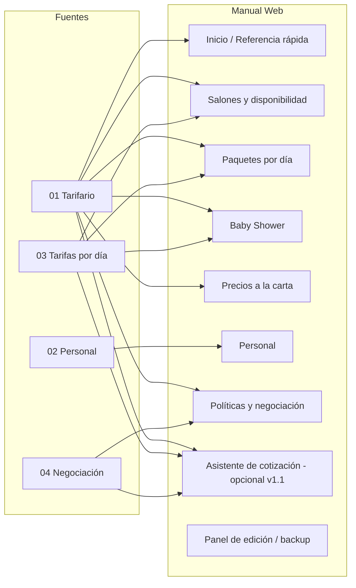
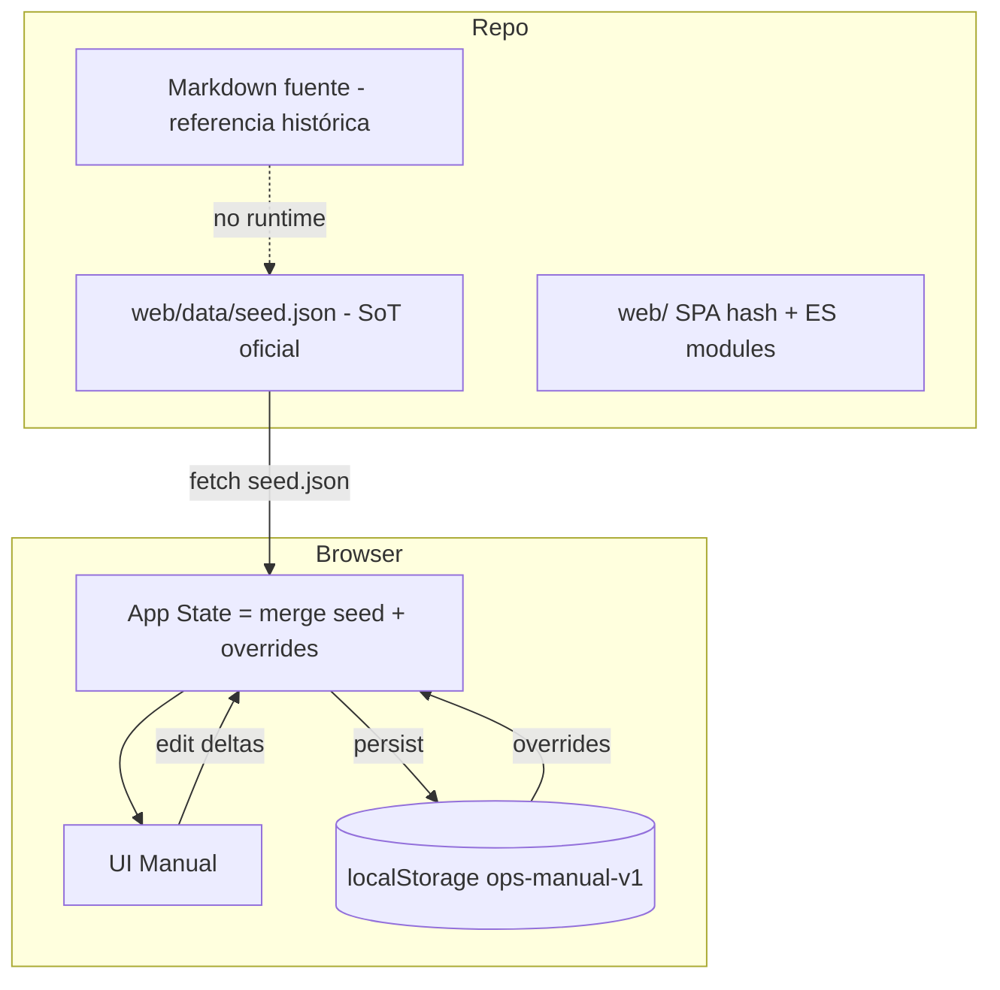
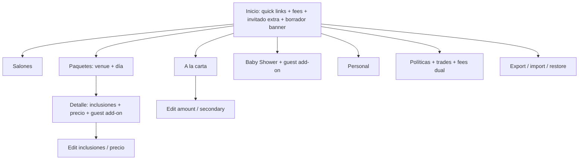
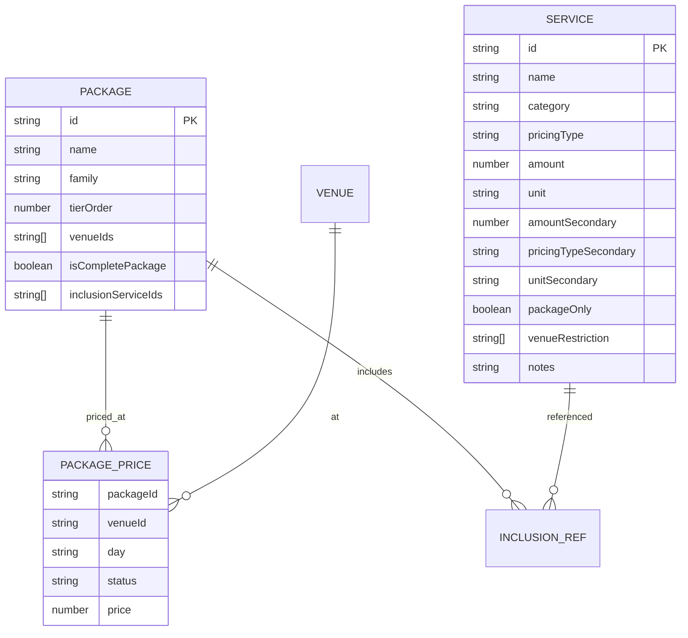
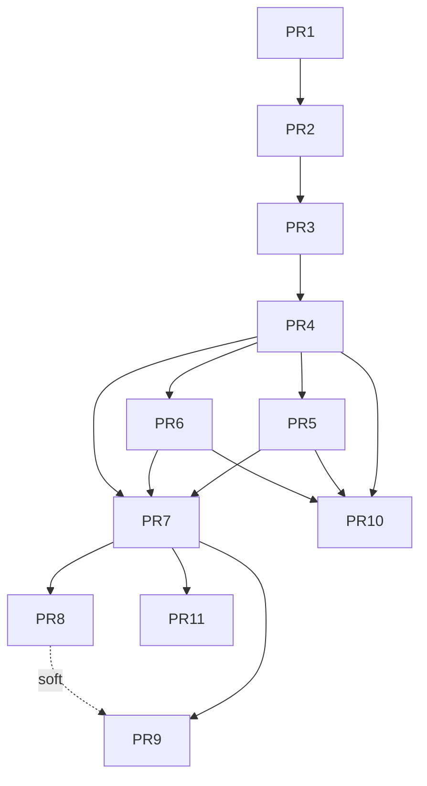

# Manual Web de Operaciones y Contrataciones — Design Document

| Campo | Valor |
| --- | --- |
| **Título** | Manual Interno Web: Operaciones, Tarifario y Contrataciones |
| **Autor** | TBD (Systems / Product Engineering) |
| **Fecha** | 2026-08-05 |
| **Estado** | Draft (rev. 3 — residual seed/format locks) |
| **Audiencia** | Staff interno de ventas y operaciones |
| **Idioma UI** | Español |
| **Workspace** | `/home/eac/Documents/MANUAL DE OPERACIONES Y CONTRATACIONES` |

---

## Overview

El workspace es **greenfield**: hoy solo existen cuatro Markdown de operaciones más `.obsidian/`; **no hay código de app web**. El equipo de ventas y operaciones depende de esos documentos dispersos (tarifario, personal, precios por día, políticas de negociación). La información es correcta pero fragmentada: precios a la carta en un archivo, paquetes por día en otro, reglas de descuento en un tercero, y el esquema de personal sin vínculo visual con capacidades de salón.

Se propone un **manual web estático tipo SPA con hash routing** (`web/index.html` + ES modules), sin backend en v1, que reorganiza todo el contenido en una IA clara, responsive y visualmente calmada. Los **precios y la composición de paquetes serán editables en el navegador** como **borradores locales** (`localStorage`), con catálogo semilla versionado en git (`web/data/seed.json`) como **sistema de registro oficial**. El objetivo es que el staff siempre tenga a mano herramientas e información para cotizar y operar correctamente.

**Cómo abrir (obligatorio en README):** servir con HTTP local, p.ej. `npx --yes serve web` o `python3 -m http.server -d web 8080`. Abrir vía `file://` es best-effort y **no** es el path soportado (ES modules).

---

## Background & Motivation

### Estado actual

| Archivo fuente | Contenido principal |
| --- | --- |
| `01. Tarifario y Politicas del Salon.md` | Condiciones de alquiler, a-la-carte, horas, invitados extra, capacidades, estructura de paquetes Gold→Deluxe, Baby Shower, fees |
| `02. Resumen del Esquema de Personal.md` | Escalones de personal por tamaño de evento (4 / 6 / 8 personas) |
| `03. Tarifas por Día del Salón Diamond y Revolution.md` | Matrices de precio por día/paquete por salón; horarios Revolution; reglas Baby Shower |
| `04. Políticas de Negociación, Intercambio de Servicios y Descuentos Permitidos..md` | Negociables, intercambios, descuentos, no negociables |

### Pain points

1. **Fragmentación**: para armar una cotización hay que cruzar 2–4 archivos.
2. **Inconsistencias de nomenclatura**: “Platinium” vs “Platino”, “Diamond” (paquete) vs “Salón Diamond”, “Limocina” vs limusina.
3. **Actualización frágil**: cambiar un precio implica editar Markdown y redistribuir el archivo; no hay UI de edición.
4. **Paquetes poco accionables**: la estructura escalonada describe inclusiones en prosa; no hay vista de tarjeta por paquete con checklist editable.
5. **Capacidad vs personal**: salones listan máx. 80 / 50 pax, pero el esquema de personal escala hasta 200 — sin nota de contexto el staff puede confundirse.
6. **No hay quick reference** para el momento de llamada o visita.

### Por qué un manual web (no solo más Markdown)

- Lectura en móvil/tablet en sala de ventas o en evento.
- Secciones navegables, búsqueda, anclas.
- Borradores de precios/paquetes en UI; tasas oficiales vía PR a seed.
- Base para un helper de cotización futura sin reescribir el contenido.

---

## Goals & Non-Goals

### Goals

1. **Un solo destino** con todo el conocimiento operativo y de contrataciones de los 4 MD.
2. **UX clara, escaneable, no recargada**: tipografía legible, jerarquía visual, mucho aire, contraste accesible (**WCAG AA baseline desde PR1/PR4**, no solo polish).
3. **Responsive** phone / tablet / desktop.
4. **Precios editables** (servicios a la carta, tarifas de salón, precios de paquete por día/venue, fees, rangos de invitado extra) como borrador local.
5. **Paquetes como entidades de primera clase**: vista individual agradable; add/remove de servicios incluidos; restauración a defaults del seed.
6. **Contenido normalizado** (typos, nombres de paquetes, notas de inconsistencias documentadas en UI).
7. **Stack simple**: hash SPA + seed JSON, servido por HTTP local estático.
8. **Implementación incremental** vía PRs pequeños y mergeables.

### Non-Goals (v1)

- Backend, auth multi-usuario o sync en la nube en tiempo real.
- Cotizador fiscal completo o generación de PDF/contratos.
- CMS headless o integración con Obsidian en runtime.
- App nativa / PWA obligatoria (PWA “add to home screen” es nice-to-have).
- Multilenguaje (solo español).
- Inventario de disponibilidad en tiempo real o calendario de reservas.
- Cumplimiento legal de impuestos (el 7% Tax se muestra como regla operativa, no como motor fiscal).
- Edición de `category` / `venueRestriction` de servicios (solo panel avanzado fuera de v1).
- Reordenamiento drag-and-drop de inclusiones.

---

## Operating Model (v1)

El producto sirve a un **equipo**, pero la persistencia v1 es **por navegador**. Sin un modelo operativo explícito, los overrides locales se confunden con tarifas oficiales.

### Roles de facto (sin auth técnica)

| Rol | Comportamiento esperado |
| --- | --- |
| **Consultor / floor staff** | Solo lectura. Usar URL con `?edit=0` o build con `FLAGS.editMode: false` en tablets/PCs compartidos de sala. |
| **Gerente / ops (1 máquina designada)** | Puede activar Modo edición para **borradores** (escenarios, pruebas, propuesta de cambio). |
| **Owner del catálogo (mismo gerente o lead)** | Propagar tarifas oficiales: exportar o editar → **PR a `web/data/seed.json`** → merge → resto del equipo recarga y **descarta overrides locales** o fusiona. |

### Políticas de producto (copy en Inicio)

1. **El seed en git es la fuente de verdad oficial.**
2. **Los cambios en el navegador son borradores locales** a este dispositivo/navegador hasta exportar e incorporar al seed.
3. **No editar solo los Markdown** para cambiar precios de runtime: el path oficial es `web/data/seed.json` (los MD quedan como archivo histórico/referencia).
4. **PCs compartidos:** desplegar o abrir siempre con `?edit=0` (o flag off) para que el floor no deje precios “sucios” para el siguiente usuario.
5. **Error de catálogo oficial** (precio incorrecto en seed): abrir issue + PR a `web/data/seed.json`; no “arreglar” solo en un tablet.
6. **Multi-pestaña mismo origen:** last-write-wins en `localStorage`; documentado, sin locking.

### Flujo de cambio de tarifa oficial

```mermaid
sequenceDiagram
  actor Gerente
  participant UI as Manual (edit mode)
  participant LS as localStorage
  participant Git as seed.json PR
  actor Staff as Floor staff

  Gerente->>UI: Ajusta precios (borrador)
  UI->>LS: deltas
  Gerente->>UI: Export JSON
  Gerente->>Git: PR actualiza seed (o aplica export)
  Note over Staff: Deploy / pull nuevo seed
  Staff->>UI: Carga seed nuevo; banner si hay deltas viejos
  Staff->>UI: Descartar locales o fusionar
```

### Feature flags de despliegue

```js
const FLAGS = {
  editMode: true,          // false en kiosko / TV / tablet de sala
  customPackages: true,
  quoteHelper: false,      // v1.1
  darkMode: false
};
// URL: ?edit=0 fuerza solo lectura aunque FLAGS.editMode === true
// URL: ?debug=1 dump de store
```

---

## Content Information Architecture

### Principio de reorganización

Los 4 archivos fuente se **desacoplan de la navegación**. Cada pantalla responde a una pregunta del staff, no a un número de archivo.

### Mapa fuente → secciones UI



### Navegación principal (sidebar + bottom nav en móvil)

| Ruta hash | Sección | Contenido derivado de | Notas de UX |
| --- | --- | --- | --- |
| `#/` | **Inicio** | Todos (síntesis) | Quick links; banners fees; no-negociable $/hr; **card Invitado adicional**; aviso “borradores locales”; prioridad sábados |
| `#/salones` | **Salones** | 01, 03 | Diamond vs Revolution: capacidad, $/hr, hora extra, horarios, venta por hora |
| `#/paquetes` | **Paquetes** | 01, 03 | Filtro venue + día; grilla; detalle inclusiones; **rango invitado adicional (otros paquetes)** en detalle |
| `#/baby-shower` | **Baby Shower** | 01, 03 | Básico/Completo; precios; horarios; prioridad sábado; **rango invitado adicional BS** |
| `#/servicios` | **A la carta** | 01 | Tabla/cards categorizada; dual price Champaña/Sidra |
| `#/personal` | **Personal** | 02 (+ nota 01) | Escalones 4/6/8 + callout capacidad vs 200; gap 101–119 |
| `#/politicas` | **Políticas** | 04 (+ fees/guest 01) | Negociables; intercambios; **trade invitados↔servicios**; descuentos; no negociables; fees default vs negociable |
| `#/editar` | **Edición / Backup** | — | Solo si edit permitido: export/import, contador overrides, restore |

### Estructura de paquetes de evento (normalizada)

| Tier ID | Nombre canónico | Alias en fuentes | `venueIds` |
| --- | --- | --- | --- |
| `gold` | Gold | Gold | diamond, revolution (matriz marca `not_sold` donde aplique) |
| `platino` | Platino | Platinium | diamond, revolution |
| `diamante` | Diamante | Diamond (paquete) | diamond, revolution |
| `deluxe` | Deluxe | Deluxe | **solo `diamond`** |

### Baby Shower (familia separada)

| ID | Nombre | Revolution | Diamond |
| --- | --- | --- | --- |
| `bs_basico` | Básico (sin DJ) | $2,497 | $2,999 |
| `bs_completo` | Completo (DJ + House) | $2,999 | $3,500 |

### Invitado adicional (surface obligatorio en UI de lectura)

| Contexto | Rango | Dónde se muestra |
| --- | --- | --- |
| Baby Shower | $35–$45 / persona | Inicio (card), detalle BS, Políticas |
| Otros paquetes | $45–$55 / persona | Inicio (card), detalle Paquete evento, Políticas |

### Callouts de contenido

| Severidad | Tema | Tratamiento en UI |
| --- | --- | --- |
| Alto | $/hr salón + mín. 4h **no negociable** | Badge en Salones y Políticas |
| Alto | **18% + 7%** por defecto en paquetes; negociables con criterio | Banner + tooltip (ver Fees dual nature) |
| Medio | Capacidad 80/50 vs staffing 200 | Callout en Personal y Salones |
| Medio | Prioridad sábados vs BS sábado | Alerta en Baby Shower |
| Medio | Cambios locales = borrador | Banner si `overrideCount > 0` |
| Bajo | Gold `not_sold` muchos días | Gris “No se vende” |
| Bajo | Mapping $0 | Tooltip confirmar gerencia |

### Fees: dual nature (obligatorio por defecto vs negociable)

Copy canónico (Políticas + tooltip del banner):

> **Service Fee (18%) e Impuestos (7%) se aplican por defecto a toda cotización de paquete.** Figuran también como conceptos **negociables** bajo criterio comercial (fuente 04). No los omitas al cotizar salvo acuerdo explícito.

En quote helper (PR11): override de fee/tax **solo** con control explícito “Ajustar cargos (negociable)”, default off.

---

## Proposed Design

### Arquitectura técnica (v1)



### Stack (decisión cerrada)

| Capa | Elección | Rationale |
| --- | --- | --- |
| Shell | **Una sola** `index.html` + **hash SPA** (`#/paquetes`) | Deep links sin servidor de paths; un solo entry |
| Módulos | JavaScript **ES modules** | Sin bundler en v1 |
| Servir | **HTTP local estático** (`npx serve web`, etc.) | Path soportado; `file://` no garantizado |
| Estilos | CSS custom properties + grid/flex | Sin dependencia pesada |
| Datos | `web/data/seed.json` | SoT versionable |
| Persistencia | `localStorage` key **`ops-manual-v1`** | Deltas tipados (no deepMerge ciego) |
| Build | Ninguno en v1 | Simplicidad |

### Estructura de carpetas

```text
/home/eac/Documents/MANUAL DE OPERACIONES Y CONTRATACIONES/
├── 01. … 04. ….md                 # fuente histórica
├── web/
│   ├── index.html
│   ├── css/
│   │   ├── tokens.css
│   │   ├── base.css               # includes :focus-visible, skip-link
│   │   ├── layout.css
│   │   └── components.css
│   ├── js/
│   │   ├── app.js                 # bootstrap + hash router
│   │   ├── store.js               # load / mergeOverrides / persist
│   │   ├── schema.js              # allowlist validation import
│   │   ├── views/
│   │   ├── components/            # Card, Callout, Badge, PackageCard, …
│   │   └── utils/
│   │       ├── money.js
│   │       └── format.js          # DAY_LABELS_ES, etc.
│   ├── data/
│   │   ├── seed.json
│   │   └── SEED_PARITY.md         # checklist MD↔seed (merge gate PR2)
│   └── assets/
└── README.md                      # servir HTTP, operating model, reportar error seed
```

### Design system visual

| Token | Propuesta |
| --- | --- |
| Tipografía | System stack o `DM Sans` / `Source Sans 3` + tabular nums en precios |
| Fondo | Neutro cálido (`#F7F5F2`), cards blancas |
| Acento | Un color de marca (deep teal o wine) |
| Densidad | Comfortable; tablas → cards en móvil |
| Componentes | App shell, Nav, Card, Badge, Table, Callout, Modal, Toast, InlinePriceEditor |
| A11y baseline | Skip link, landmarks, contraste AA en tokens, labels en controles, focus visible — **PR1/PR4** |
| Dark mode | No v1 |

### Wireframes lógicos



### Vista Paquetes (detalle)

- Header: tier + badges venue/día + status UI.
- Precio grande si `available`; si no, label de status (ver enum).
- Badges “+18%” “+7%” (**no** total calculado automático en v1; si se muestra estimación: *“estimación; confirmar orden de cargos”*).
- Inclusiones denormalizadas con checkmarks; en edición: remove + picker.
- Card/sección **Invitado adicional: $45–$55 / persona** (otros paquetes).
- Acciones: Duplicar custom; Restaurar inclusiones seed; Restaurar precio celda.
- Deluxe solo listado cuando `venue === diamond` (filtro por `venueIds`).

### Status de celda de precio (enum cerrado)

| `status` | Significado | UI |
| --- | --- | --- |
| `available` | Se vende a `price` | Precio formateado |
| `not_sold` | Producto existe para el venue pero **no se vende ese día** (ej. Gold vie/sáb Diamond) | Gris “No se vende”; `price` debe ser `null` |
| `unavailable_venue` | Paquete **no aplica** a ese venue (ej. Deluxe/Revolution) | No mostrar en grilla **o** “No aplica”; **no** se puede pasar a `available` |

**Reglas de seed y store:**

1. Filas de matriz: emitir celdas `available` y `not_sold` para combinaciones en `package.venueIds × days`.
2. **No** emitir (o emitir solo `unavailable_venue` si se quiere exhaustividad) celdas fuera de `venueIds`.
3. `updatePackagePrice`: si `packageId` no incluye `venueId` en `venueIds` → **hard error** (no soft warning). KD-7 enforced.
4. Transición `not_sold` → `available` **requiere** `price != null && price >= 0`.
5. Transición a `not_sold` setea `price: null`.

### Vista A la carta / Personal / BS

- A la carta: categorías; dual price en Champaña/Sidra; badges venue.
- Personal: 3 escalones; callout 200; nota gap **101–119**: UI muestra el hueco; recomendación provisional usar escalón de 100 hasta 119 (OQ-5).
- BS: dos cards; guest add-on BS; horarios y prioridad sábado.

### Asistente de cotización (v1.1, data-ready)

1. Venue + día + paquete (solo `available`).
2. Invitados (warning si > capacity).
3. Extras / swaps / guest trades (prosa + structured swaps).
4. Descuento $500–$1000 solo si `isCompletePackage`.
5. Desglose fee/tax con fórmula provisional etiquetada; override fee solo con opt-in.
6. Copy texto plano.

---

## Data Model

### Decisiones de modelado (cerradas)

| Tema | Decisión v1 |
| --- | --- |
| Inclusiones | **Lista denormalizada** `inclusionServiceIds: string[]` por paquete (full set, no herencia runtime) |
| Restore inclusiones | Borrar delta `packageInclusions[id]` → vuelve a `seed.packages[id].inclusionServiceIds` |
| `inheritedFromLowerTier` | **No se usa en runtime**; omitido del schema v1 (la prosa escalonada solo documenta cómo se construyó el seed) |
| Dual price | Campos opcionales `amountSecondary`, `pricingTypeSecondary`, `unitSecondary` en SERVICE |
| Precio paquete key | Composite string `packageId\|venueId\|day`; **única regla** si `day == null` → segmento **`_`** (nunca el literal `"null"`). Ej. BS: `bs_basico|revolution|_` |
| Custom packages | Array completo en overrides `customPackages[]`; no están en seed |

### ER (simplificado v1)



### SERVICE — tipos de pricing

| `pricingType` | Render | Campos |
| --- | --- | --- |
| `flat` | `$450` | `amount` |
| `per_person` | `$7 / persona` | `amount`, `unit: "persona"` |
| `additive` | `+$380` + badge variable | `amount`, notes |
| `included` | “Incluido en paquete” / sin precio a la carta | `amount: null`, `packageOnly: true` |
| `derived` | Texto explicativo (hora extra de evento) | `amount: null`, `packageOnly: true`, notes apuntan a venue extra hour |

**Dual / secondary (Champaña, Sidra):**

```json
{
  "id": "champana",
  "name": "Champaña",
  "category": "bar",
  "pricingType": "flat",
  "amount": 15,
  "unit": null,
  "pricingTypeSecondary": "per_person",
  "amountSecondary": 8,
  "unitSecondary": "persona",
  "venueRestriction": [],
  "packageOnly": false,
  "notes": "Fuente: $15 ($8 / persona)"
}
```

Render lectura: **`$15`** · _o_ **`$8 / persona`**.

**Edit UX v1:** ambos campos editables en modo edición (dos inputs). Si `amountSecondary == null`, un solo input.

### Catálogo completo de servicios (seed obligatorio)

#### A la carta (preciados, `packageOnly: false`)

| id | name | category | pricingType | amount | secondary | venueRestriction |
| --- | --- | --- | --- | --- | --- | --- |
| hora_loca | Hora Loca | entretenimiento | flat | 450 | — | [] |
| piso_luminico | Piso Lumínico | decoracion | flat | 1200 | — | [] |
| dj | DJ (4 horas / Show) | entretenimiento | flat | 350 | — | [] |
| mapping | Mapping | entretenimiento | flat | 0 | — | [] |
| deco_basica | Decoración Básica (State y mesas) | decoracion | flat | 380 | — | [] |
| deco_premium | Decoración Premium (Full) | decoracion | additive | 380 | — | [] |
| cake | Cake | catering | per_person | 2 | — | [] |
| comida | Comida | catering | per_person | 7 | — | [] |
| mesa_quesos | Mesa de quesos | catering | per_person | 3 | — | [] |
| mesa_dulces | Mesa de dulces | catering | per_person | 3 | — | [] |
| pasapalos | Pasapalos | catering | per_person | 6 | — | [] |
| animador | Animador | entretenimiento | flat | 350 | — | [] |
| bailarina | Bailarina | entretenimiento | flat | 350 | — | [] |
| maestro_ceremonia | Maestro de ceremonia | entretenimiento | flat | 350 | — | [] |
| photobooth_360 | Photobooth 360 | foto | flat | 350 | — | [revolution] |
| photobooth_print | Photobooth Print | foto | flat | 450 | — | [diamond] |
| bar_house | Bar Abierto Licor House | bar | per_person | 10 | notes: 4 horas | [] |
| bar_premium | Bar Abierto Licor Premium | bar | per_person | 18 | notes: 4 horas | [] |
| champana | Champaña | bar | flat | 15 | per_person 8 | [] |
| sidra | Sidra | bar | flat | 6 | per_person 8 | [] |
| vajilla | Vajilla / Platos / Cubiertos / Chafing Dish | catering | per_person | 10 | — | [] |
| personal_servicio | Personal de Servicio | personal | flat | 150 | notes: 6 horas | [] |
| violinista | Violinista | entretenimiento | flat | 350 | — | [] |
| deco_exterior | Decoración Exterior (Bebida y pasapalos) | decoracion | flat | 600 | — | [] |
| foto_sola | Fotografía Solo Foto | foto | flat | 550 | — | [] |
| foto_video_album | Foto + Video + Álbum + Afiche | foto | flat | 1000 | — | [] |

#### Solo paquete / virtuales (`packageOnly: true`)

| id | name | pricingType | notes / mapping desde prosa |
| --- | --- | --- | --- |
| mesas_sillas | Mesas y sillas | included | Gold base |
| luces | Luces | included | Gold base |
| sonido | Sistema de sonido | included | Gold / BS |
| servicio | Servicio (staff de paquete) | included | Gold “servicio”; distinto de línea a-la-carte `personal_servicio` cuando se cotiza aparte |
| pantalla_luces | Pantalla / luces / LED Video | included | Gold “pantalla/luces”; BS “Pantalla LED / Video” |
| alquiler_salon | Alquiler de salón | included | BS; el $ de paquete ya lo incluye |
| vino | Servicio de vino | included | BS Básico |
| limusina | Limusina | included | Diamante+; swap ↔ hora_loca |
| hora_extra_evento | 1 hora extra de evento | derived | Diamante+; valor de mercado = `venue.extraHourWithPackage` (informativo; no doble cobro en UI de paquete) |
| aperitivos | Aperitivos / entradas | included | Deluxe |
| meseros_bs | Meseros / Servers | included | BS (prosa); alineado a staffing de evento pequeño |

> **Decoración premium interior y exterior (Deluxe):** dos inclusiones: `deco_premium` + `deco_exterior` (no un solo id ambiguo).

> **Platino “pastel y personal”:** `cake` + `personal_servicio`.

### Inclusiones denormalizadas por paquete (autoritativas)

```text
gold =
  mesas_sillas, luces, sonido, servicio, comida, vajilla, dj, pantalla_luces

platino = gold +
  bar_house, cake, personal_servicio

diamante = platino +
  hora_extra_evento, limusina, mesa_quesos

deluxe = diamante +
  foto_video_album, hora_loca, aperitivos, bar_premium, deco_premium, deco_exterior
  # venueIds: [diamond] only

bs_basico =
  alquiler_salon, comida, pantalla_luces, deco_basica, cake,
  meseros_bs, sonido, vajilla, vino

bs_completo = bs_basico +
  dj, bar_house
```

`isCompletePackage`: `true` para `gold`, `platino`, `diamante`, `deluxe`, `bs_completo`; `false` para `bs_basico` (provisional KD-15 / OQ-2: descuento $500–$1000 aplica a cualquier paquete con flag true).

### packagePrices — matrices (status + price)

**Días evento:** `friday` | `saturday` | `sunday`  
**BS:** `day: null` (key `packageId|venueId|_`)

**Diamond**

| day | gold | platino | diamante | deluxe |
| --- | --- | --- | --- | --- |
| friday | not_sold | available 8500 | available 9500 | available 10000 |
| saturday | not_sold | available 8500 | available 10000 | available 12000 |
| sunday | not_sold | available 5000 | available 6500 | available 7500 |

**Revolution** (sin filas deluxe → omitidas o `unavailable_venue` si se generan por script)

| day | gold | platino | diamante |
| --- | --- | --- | --- |
| friday | not_sold | available 3800 | available 4800 |
| saturday | not_sold | available 5000 | available 6500 |
| sunday | available 3000 | available 3200 | available 3800 |

**Baby Shower**

| package | revolution | diamond |
| --- | --- | --- |
| bs_basico | 2497 | 2999 |
| bs_completo | 2999 | 3500 |

### policies (seed)

```json
{
  "negotiable": [
    "Service Fee",
    "Tax",
    "Cantidad de invitados",
    "Servicios adicionales"
  ],
  "negotiableFeesNote": "Service Fee e Impuestos se muestran por defecto en toda cotización; son negociables solo con criterio comercial.",
  "allowedSwaps": [
    {
      "fromServiceId": "limusina",
      "toServiceId": "hora_loca",
      "note": "Limusina ↔ Hora Loca"
    }
  ],
  "tradeExamples": [
    {
      "id": "guests_for_service",
      "text": "Se pueden agregar más invitados omitiendo o removiendo otros servicios del paquete (ejemplo: quitar Mesa de Quesos).",
      "exampleRemoveServiceId": "mesa_quesos"
    }
  ],
  "discount": {
    "min": 500,
    "max": 1000,
    "requiresCompletePackage": true
  },
  "nonNegotiable": [
    "Precio por hora del salón (mínimo de contratación de 4 horas)"
  ],
  "guestAddOn": {
    "babyShower": { "min": 35, "max": 45 },
    "otherPackages": { "min": 45, "max": 55 }
  }
}
```

> Nota: `guestAddOn` puede vivir top-level **o** bajo `policies`; v1 seed lo coloca **top-level** (como antes) **y** se referencia desde Políticas/UI. Un solo objeto top-level `guestAddOn` es la fuente; Políticas solo lo renderiza.

### Esquema seed — contratos concretos (venues, schedules, staffing)

Los catálogos `services[]` / `packages[]` / `packagePrices[]` / `policies` están definidos en las tablas y fragmentos anteriores. A continuación, **shapes JSON autoritativos** (nombres de clave + valores de fuente) que PR2 debe copiar sin inventar árboles alternativos.

#### `venues[]` (números = fuentes 01)

```json
[
  {
    "id": "diamond",
    "name": "Salón Diamond",
    "capacityMax": 80,
    "hourlyRate": 500,
    "minHours": 4,
    "extraHourWithPackage": 800,
    "extraHourWithoutPackage": 500,
    "locationNote": "Doral"
  },
  {
    "id": "revolution",
    "name": "Salón Revolution",
    "capacityMax": 50,
    "hourlyRate": 300,
    "minHours": 4,
    "extraHourWithPackage": 600,
    "extraHourWithoutPackage": 300,
    "locationNote": null
  }
]
```

#### `schedules` (árbol de claves cerrado — diseño, no inventar en implementación)

```json
{
  "generalHourlySale": {
    "days": ["tuesday", "wednesday", "thursday", "sunday"],
    "window": "10:00–17:00",
    "notes": "Solo se vende el salón por hora. Si el evento es dentro de menos de un mes se puede vender cualquier hora excepto sábado, o si no hay eventos."
  },
  "revolutionByDay": {
    "friday": ["any"],
    "saturday": ["13:00–17:00", "20:00–02:00"],
    "sunday": ["12:00–16:00", "18:00–02:00"]
  },
  "babyShower": {
    "regularWindow": "12:00–16:00",
    "allowedDays": ["tuesday", "wednesday", "thursday"],
    "saturdayException": "13:00–17:00",
    "priorityRule": "Priorizar siempre la reserva de sábados para paquetes de eventos grandes."
  }
}
```

- `revolutionByDay.*.[]` strings: `"any"` = cualquier hora ese día; resto = ventanas `HH:MM–HH:MM` (24h).
- Diamond no tiene bloque `diamondByDay` en fuentes 03 para horarios de paquete (solo matriz de precio); horarios generales de venta por hora viven en `generalHourlySale`.

#### `staffingTiers[]` (fuente 02; gap 101–119 es solo UI/OQ-5)

```json
[
  {
    "id": "lt_100",
    "label": "Menos de 100 personas",
    "guestMin": 1,
    "guestMax": 99,
    "totalStaff": 4,
    "roles": {
      "coordinador": 1,
      "bartender": 1,
      "cocina": 1,
      "mesero": 1
    }
  },
  {
    "id": "eq_100",
    "label": "100 personas",
    "guestMin": 100,
    "guestMax": 100,
    "totalStaff": 6,
    "roles": {
      "coordinador": 1,
      "bartender": 1,
      "cocina": 2,
      "mesero": 2
    }
  },
  {
    "id": "gte_120",
    "label": "120 o más (máx. 200)",
    "guestMin": 120,
    "guestMax": 200,
    "totalStaff": 8,
    "roles": {
      "coordinador": 1,
      "bartender": 2,
      "cocina": 2,
      "mesero": 3
    }
  }
]
```

#### Fragmento raíz `seed.json` (ensamblado)

```json
{
  "version": 1,
  "meta": {
    "currency": "USD",
    "locale": "es",
    "updatedAt": "2026-08-05",
    "sourceFiles": [
      "01. Tarifario y Politicas del Salon.md",
      "02. Resumen del Esquema de Personal.md",
      "03. Tarifas por Día del Salón Diamond y Revolution.md",
      "04. Políticas de Negociación, Intercambio de Servicios y Descuentos Permitidos..md"
    ]
  },
  "fees": {
    "serviceFeePercent": 18,
    "taxPercent": 7,
    "notes": "Todos los paquetes llevan 18% Service Fee + 7% Tax por defecto."
  },
  "venues": [ "/* ver venues[] arriba */" ],
  "schedules": { "/* ver schedules arriba */" },
  "services": [ "/* catálogo real + virtual: tablas de este doc */" ],
  "packages": [
    {
      "id": "platino",
      "name": "Platino",
      "family": "event",
      "tierOrder": 2,
      "venueIds": ["diamond", "revolution"],
      "isCompletePackage": true,
      "description": "Gold + bar House, pastel y personal.",
      "inclusionServiceIds": [
        "mesas_sillas", "luces", "sonido", "servicio", "comida", "vajilla",
        "dj", "pantalla_luces", "bar_house", "cake", "personal_servicio"
      ]
    }
  ],
  "packagePrices": [ "/* matrices + BS: tablas packagePrices de este doc */" ],
  "guestAddOn": {
    "babyShower": { "min": 35, "max": 45 },
    "otherPackages": { "min": 45, "max": 55 }
  },
  "staffingTiers": [ "/* ver staffingTiers[] arriba */" ],
  "policies": { "/* negotiable, allowedSwaps, tradeExamples, discount, nonNegotiable */" },
  "contentNotes": [
    {
      "id": "capacity_vs_staffing",
      "severity": "medium",
      "pages": ["personal", "salones"],
      "text": "Las capacidades de salón (Diamond 80 / Revolution 50) no cubren el escalón de personal hasta 200. Usar staffing como guía operativa general o multi-espacio; validar con gerencia."
    }
  ]
}
```

---

## Persistencia: contrato de overrides (implementable)

### Key y forma

- **Key:** `localStorage["ops-manual-v1"]`
- **No** usar deepMerge genérico sobre arrays.
- Merge **por id** / **por composite key**; inclusiones = **reemplazo total** del array.

### Schema de overrides

```json
{
  "seedVersion": 1,
  "updatedAt": "2026-08-05T18:00:00.000Z",
  "services": {
    "dj": { "amount": 400 },
    "champana": { "amount": 15, "amountSecondary": 9 }
  },
  "venues": {
    "diamond": { "hourlyRate": 500, "extraHourWithPackage": 800 }
  },
  "fees": {
    "serviceFeePercent": 15
  },
  "guestAddOn": {
    "babyShower": { "min": 35, "max": 40 }
  },
  "packagePrices": {
    "platino|diamond|friday": { "price": 8000, "status": "available" },
    "gold|revolution|sunday": { "price": null, "status": "not_sold" }
  },
  "packageInclusions": {
    "platino": [
      "mesas_sillas", "luces", "sonido", "servicio", "comida", "vajilla",
      "dj", "pantalla_luces", "bar_house", "cake"
    ]
  },
  "packageMeta": {
    "platino": { "name": "Platino (ajustado)" }
  },
  "customPackages": [
    {
      "id": "custom_a1b2",
      "name": "Platino sin pastel",
      "family": "custom",
      "originPackageId": "platino",
      "tierOrder": 100,
      "venueIds": ["diamond", "revolution"],
      "isCompletePackage": true,
      "inclusionServiceIds": ["mesas_sillas", "dj", "bar_house"],
      "description": "Variante local"
    }
  ],
  "removedCustomPackageIds": []
}
```

**Composite key helper:**

```js
/** Canonical composite key. day null/undefined ALWAYS becomes '_' (never the string "null"). */
function priceKey(packageId, venueId, day) {
  return `${packageId}|${venueId}|${day == null ? '_' : day}`;
}
// Examples: priceKey('platino','diamond','friday') === 'platino|diamond|friday'
//           priceKey('bs_basico','revolution', null) === 'bs_basico|revolution|_'
```

### Algoritmo `mergeCatalog(seed, overrides) → effective`

1. Validar `overrides` con allowlist (ver Security). Si inválido → ignorar LS + toast error.
2. Clonar seed (`structuredClone`).
3. **fees / guestAddOn:** `Object.assign` campos conocidos.
4. **venues:** por `id`, patch campos allowlist: `hourlyRate`, `minHours`, `extraHourWithPackage`, `extraHourWithoutPackage`, `capacityMax` (opcional).
5. **services:** por `id` **solo si el id ya existe en seed** (patch): `amount`, `amountSecondary`, `pricingType`, `pricingTypeSecondary`, `unit`, `unitSecondary`, `notes`, `name`. **No insert** de ids nuevos en v1.0 (sin `custom_svc_*`). **No** patch `venueRestriction` / `category` / `packageOnly` en v1 UI. Si un override referencia un service id ausente en seed → drop key + warn en `?debug=1`.
6. **packagePrices:** para cada key en overrides, find row o insert; set `price`/`status`; validar Deluxe/venue y not_sold↔price.
7. **packageInclusions:** si key presente, **reemplazar** `packages[id].inclusionServiceIds` por el array del override (full replace).
8. **packageMeta:** patch name/description opcionales.
9. **customPackages:** append a `packages` (effective); precios custom viven en `packagePrices` con su id.
10. **removedCustomPackageIds:** filtrar custom (no borra seed canónicos).
11. Si `overrides.seedVersion < seed.version` → UI banner migración (ver abajo).

### Persistencia al editar

| API | Escribe en overrides |
| --- | --- |
| `updateService(id, patch)` | `services[id]` merge patch |
| `updateVenue(id, patch)` | `venues[id]` |
| `updateFees(patch)` | `fees` |
| `updateGuestAddOn(patch)` | `guestAddOn` |
| `updatePackagePrice({packageId,venueId,day,price,status})` | `packagePrices[priceKey(...)]`; hard fail si venue ineligible |
| `setPackageInclusions(packageId, serviceIds[])` | `packageInclusions[id] = [...serviceIds]` full replace |
| `addServiceToPackage` / `removeServiceFromPackage` | leen effective list → `setPackageInclusions` |
| `createCustomPackage(fromId, name)` | push objeto full en `customPackages`; copia inclusiones |
| `deleteCustomPackage(id)` | saca de `customPackages`; push id a `removedCustomPackageIds`; limpia keys de precio/inclusiones |
| `resetEntity('service'\|'packageInclusions'\|…, id)` | delete key del mapa |
| `resetAll()` | `removeItem` |
| `exportCatalog()` | descarga JSON: opción A solo overrides; opción B effective full (default **overrides** + meta para PR-friendly) |
| `importCatalog(json, mode)` | `replace`: sustituye LS; `merge`: deep-merge **por las mismas reglas de mapas** (no arrays por índice) |

### Ejemplos trabajados

**E1 — Editar precio DJ 350 → 400**

```json
{ "seedVersion": 1, "services": { "dj": { "amount": 400 } } }
```

**E2 — Quitar cake de Platino**

Override guarda la lista completa **sin** `cake` (no un op “remove”). Restore = borrar `packageInclusions.platino`.

**E3 — Custom package**

`customPackages: [{ id: "custom_…", originPackageId: "platino", inclusionServiceIds: [...], … }]`  
Precios opcionales en `packagePrices["custom_…|diamond|friday"]`.

**E4 — Seed bump 1 → 2**

Banner: “Catálogo oficial v2 disponible.”

- **Descartar locales:** `resetAll` + reload.
- **Fusionar:** mantener overrides; keys huérfanas (id eliminado del seed) se dropean al merge; inclusiones custom se conservan; `seedVersion` en LS se actualiza a 2 tras confirmación.

### Multi-tab

Last-write-wins. Opcional: `storage` event para re-merge en otras tabs (nice-to-have PR9).

---

## money.js y format.js

```js
// format.js
export const DAY_LABELS_ES = {
  monday: 'Lunes',
  tuesday: 'Martes',
  wednesday: 'Miércoles',
  thursday: 'Jueves',
  friday: 'Viernes',
  saturday: 'Sábado',
  sunday: 'Domingo'
};

export function dayLabel(day) {
  if (day == null) return '—';
  return DAY_LABELS_ES[day] ?? day;
}

// money.js
/** Round half up to cents */
export function roundMoney(n) {
  return Math.round((Number(n) + Number.EPSILON) * 100) / 100;
}

/**
 * Display currency. Always allow cents (max 2) so fee-cascade totals are not truncated.
 * minimumFractionDigits: 0 so whole seed prices still render as $2,497 not $2,497.00.
 * For package matrix cells (whole dollars only), callers may pass { maximumFractionDigits: 0 }.
 */
export function formatMoney(n, locale = 'es-US', opts = {}) {
  const max = opts.maximumFractionDigits ?? 2;
  const min = opts.minimumFractionDigits ?? 0;
  return new Intl.NumberFormat(locale, {
    style: 'currency',
    currency: 'USD',
    minimumFractionDigits: min,
    maximumFractionDigits: max
  }).format(n);
}
// Prefer: formatMoney(computePackageTotal(...)) → up to 2 dp
// Matrix: formatMoney(8500, 'es-US', { maximumFractionDigits: 0 })

/**
 * Provisional formula (KD-15 / OQ-1) until business confirms.
 * total = round( (base - discount) * (1 + fee) * (1 + tax) )
 * Round to cents at the end only for display totals; intermediate may use full float then final roundMoney.
 */
export function computePackageTotal(base, {
  serviceFeePercent,
  taxPercent,
  discount = 0
}) {
  const taxable = Math.max(0, base - discount);
  const withFee = taxable * (1 + serviceFeePercent / 100);
  const withTax = withFee * (1 + taxPercent / 100);
  return roundMoney(withTax);
}
```

**UI rule:** package cards may show fee **badges** always. Any **computed total** must label: *“Estimación; confirmar orden de cargos con gerencia.”* No total engañoso en modo lectura v1 salvo helper.

---

## Edit UX Flows

### Principios

- Lectura por defecto; toggle “Editar” solo si `FLAGS.editMode && query edit≠0`.
- Debounce persist 300ms; toast “Guardado (borrador local)”.
- Confirmación en restore all / delete custom.
- **Multi-tab:** last-write-wins (documentado en panel Edición).

### Scope de edición v1 (lock)

| Editable | No editable en UI v1 |
| --- | --- |
| `amount`, `amountSecondary` | `category`, `packageOnly` |
| package `price` + `status` (con validaciones) | `venueRestriction` (advanced futuro) |
| `inclusionServiceIds` (add/remove) | Reorder inclusiones |
| fees %, guestAddOn min/max | Borrar paquetes canónicos seed |
| venue hourly / extra hour | — |
| custom package create/delete | Crear servicio nuevo (`custom_svc_*`) — deferred v1.1 |

### Flujo A — Precio servicio

Inline/drawer; dual fields si `amountSecondary != null`. Validar `>= 0`; soft-warn `> 100000`.

### Flujo B — Precio paquete

- Click precio si `available` o al habilitar venta.
- `not_sold` → `available` exige precio.
- Venue ineligible: control deshabilitado; store hard-error si se llama API.

### Flujo C — Inclusiones

- Remove → full list rewrite en overrides.
- Add: **picker only** sobre `services` del catálogo efectivo (seed + overrides de amount en ids existentes).
- **Fuera de PR8 / v1.0:** texto libre, `labelOverride` ad-hoc, y **“Crear servicio nuevo”** (`custom_svc_*`). No hay semántica de insert en `mergeCatalog` step 5 (solo patch de ids que ya existen en seed). Si en v1.1 se reintroduce create-service, requerirá upsert documentado (full object + `name`/`pricingType`/`amount` required) — **no implementar en PR8**.
- Restore inclusiones: `resetEntity('packageInclusions', id)`.
- Denormalizado: quitar de Platino **no** altera Gold ni Diamante seed (cada paquete independiente).
- Custom **packages** (duplicar paquete) sí están en PR8; eso no crea filas nuevas en `services[]`.

### Flujo D — Fees / guest add-on

Panel Políticas o `#/editar`.

### Flujo E — Export / import / restore

Como tabla original + validación Security.

---

## API store.js (contrato)

```js
export async function loadCatalog()
export function getCatalog()
export function getOverrides()
export function getOverrideCount()
export function updateService(id, patch)
export function updatePackagePrice({ packageId, venueId, day, price, status })
export function setPackageInclusions(packageId, serviceIds)
export function addServiceToPackage(packageId, serviceId)
export function removeServiceFromPackage(packageId, serviceId)
export function createCustomPackage(fromPackageId, name)
export function deleteCustomPackage(id)
export function updateFees(patch)
export function updateGuestAddOn(patch)
export function updateVenue(id, patch)
export function resetAll()
export function resetEntity(type, idOrKey)
export function exportOverrides()      // recommended default download
export function exportEffectiveCatalog()
export function importCatalog(json, mode /* 'merge' | 'replace' */)
export function subscribe(listener)
```

---

## Alternatives Considered

### A1. Solo mejorar Markdown en Obsidian

Pros: cero código. Contras: sin edición UI, sin paquetes interactivos. **Rechazado** como producto final.

### A2. React/Vite SPA + JSON

Pros: componentes. Contras: build y deps de más. **Diferido**; upgrade path si crece UI.

### A3. Google Sheets / Notion

Pros: colab nativa. Contras: fuera del workspace. **Rechazado** como core.

### A4. Backend + auth

Pros: sync real. Contras: ops/hosting. **Diferido**; misma shape JSON → API.

### A5. Multipage HTML sin estado

Pros: simple. Contras: edición inviable. **Rechazado**.

### A6. SSG (11ty / MkDocs) read-only + página de edición separada

Pros: excelente manual estático, search built-in, deploy docs. Contras: precios/paquetes editables y restore defaults exigen estado cliente y un modelo de datos igual de rico; se fragmenta en “docs + mini-app”. **Rechazado para v1** a favor de una sola SPA hash que es a la vez manual y editor de borradores; SSG reevaluable si se abandona edición local.

---

## Security & Privacy

| Amenaza | Severidad | Mitigación |
| --- | --- | --- |
| Exposición tarifas si repo/host público | Media | Uso interno; noindex si se hostea; README |
| XSS vía import | Media | Solo `textContent`; no `innerHTML` con datos |
| Prototype pollution / JSON hostil | Media | Ver pipeline import abajo |
| Pérdida de borradores | Media | Export; banner overrides |
| PC compartido contamina precios | Media–Alta | Operating model: `?edit=0` / flag; borrador local explícito |
| PII clientes | N/A v1 | No se guardan |

### Pipeline `importCatalog`

1. Reject if `typeof json !== 'object'` or `JSON.stringify` size **> 1MB**.
2. `JSON.parse` only from `File.text()`; never `eval`.
3. Pass through **allowlist schema** (`schema.js`): top-level keys only  
   `seedVersion | updatedAt | services | venues | fees | guestAddOn | packagePrices | packageInclusions | packageMeta | customPackages | removedCustomPackageIds`  
   (o full effective seed keys si import mode full-catalog — validar `version` + same entity shapes).
4. Strip keys starting with `__` ; no merge into `Object.prototype` (assign onto `Object.create(null)` maps).
5. `structuredClone` del subset limpio antes de persistir.
6. Run business validators (Deluxe venue, price/status coherence).

---

## Observability

| Señal | Enfoque |
| --- | --- |
| Debug | `?debug=1` → dump seed version, override count, keys |
| Parse/import errors | Banner + mensaje |
| Health | Panel Edición: overrides, seedVersion, updatedAt |
| Reporte catálogo oficial | README: issue + PR a `web/data/seed.json` (no solo MD) |
| Totals | Siempre etiquetados si se calculan |

---

## Rollout Plan

| Fase | Entrega | Done |
| --- | --- | --- |
| P0 | Shell + router + a11y baseline | Navegable |
| P1 | Seed completo + parity checklist | PR2 merge gate |
| P2 | Store merge/overrides | Tests ejemplos E1–E4 |
| P3 | Lectura 100% fuentes | PR6 |
| P4 | Edit precios | Persist + dual price |
| P5 | Edit inclusiones + custom | Restore works |
| P6 | Export/import harden | PR9 |
| P7 | Polish search | PR10 |
| P8 | Quote helper opcional | PR11 flag off default |

Rollback: git revert estático; LS del usuario independiente.

---

## Key Decisions

| # | Decisión | Rationale |
| --- | --- | --- |
| KD-1 | Static **hash SPA** + vanilla JS + `seed.json`, sin backend | Greenfield en carpeta Obsidian; bajo costo |
| KD-2 | **Overrides tipados en localStorage**; seed git = SoT oficial | Borradores locales vs tarifas auditables |
| KD-3 | IA por tarea del staff, no por # de archivo | Menos carga cognitiva |
| KD-4 | Paquetes como entidades con precios (venue, day) e inclusiones por service id | Cards + edit add/remove |
| KD-5 | Normalizar Platino / Diamante / Limusina en UI | Evita errores comerciales |
| KD-6 | Baby Shower familia separada | SKUs e inclusiones distintos |
| KD-7 | Deluxe solo Diamond: `venueIds` + **hard error** en store | Regla de negocio estricta |
| KD-8 | Fees 18%+7% banner + datos editables; copy dual nature | Default obligatorio, negociable con criterio |
| KD-9 | UI en español | Audiencia y fuentes |
| KD-10 | Quote helper en v1.1; badges fee sin total silencioso | Evita cotizaciones falsas (OQ-1) |
| KD-11 | Callout capacidad vs staffing 200 | Superficia inconsistencia real |
| KD-12 | Export/import como puente multi-dispositivo y PR al seed | Sin cloud sync |
| KD-13 | **Hash SPA + ES modules; HTTP local es path primario** (`npx serve web`); `file://` best-effort | Cierra ambigüedad multipage; evita footgun modules |
| KD-14 | **Inclusiones denormalizadas** full list por paquete; restore = drop delta | Simple, predecible para PR8 |
| KD-15 | **Provisional hasta confirmación negocio:** (a) total = `(base−dto)×(1+fee)×(1+tax)` con `roundMoney` final; (b) `isCompletePackage=true` en gold/platino/diamante/deluxe/bs_completo para descuento | Desbloquea código; OQ-1/OQ-2 siguen abiertos a validación |
| KD-16 | **Operating model:** floor read-only (`?edit=0`); edición en máquina gerente; oficiales vía PR seed | Mitiga multi-user localStorage |
| KD-17 | **Status enum** `available \| not_sold \| unavailable_venue` | Distingue N/S vs N/A |
| KD-18 | Dual price via `amountSecondary` + `pricingTypeSecondary` | Fidelity Champaña/Sidra |

---

## Risks

| Riesgo | Severidad | Mitigación |
| --- | --- | --- |
| Borradores no exportados / PCs distintos | Alta | Operating model; banner; export CTA; kiosk `?edit=0` |
| Orden fee/tax incorrecto | Alta | KD-15 provisional; no total silencioso; OQ-1 |
| Drift MD vs seed | Media | SEED_PARITY.md merge gate; proceso “seed first” |
| Scope CRM | Media | Non-goals |
| Inclusiones prosa incompletas | Media | Listas autoritativas en este doc; ajustar con gerencia |
| ES modules sin HTTP | Media | README + KD-13 |

---

## Open Questions

| ID | Pregunta | Default v1 (provisional) |
| --- | --- | --- |
| OQ-1 | ¿Cascada fee×tax sobre (base−dto)? | **Sí** — KD-15 |
| OQ-2 | ¿Qué es “Paquete Completo” para dto $500–$1000? | `isCompletePackage===true` (incl. tiers evento + BS completo; excl. BS básico) — KD-15 |
| OQ-3 | ¿Gold no se vende en Diamond es permanente en vie/sáb/dom? | `not_sold` en los tres días listados |
| OQ-4 | Mapping $0 | Mostrar 0 + nota gerencia |
| OQ-5 | Staffing 101–119 | UI muestra gap; recomendar escalón 100 hasta 119 |
| OQ-6 | Brand kit | Neutro profesional |
| OQ-7 | Hosting | Local/LAN static; kiosk `?edit=0` |

---

## References

- Fuentes workspace: `01`–`04` Markdown en `/home/eac/Documents/MANUAL DE OPERACIONES Y CONTRATACIONES/`
- Prior art IA: MkDocs/11ty (inspiración; rechazados como app editable — A6)
- local-first: deltas por id, no CRDT en v1

---

## PR Plan

Cada PR mergeable e independiente en lo posible. **Contratos de datos de este doc son gate de PR2/PR3.**

### PR1 — Scaffold hash SPA, tokens, a11y baseline

| | |
| --- | --- |
| **Título** | `feat(web): scaffold hash SPA, layout shell, tokens y a11y baseline` |
| **Archivos** | `web/index.html`, `web/css/*`, `web/js/app.js` (hash router), `README.md` (serve HTTP, `?edit=0`, operating model corto) |
| **Deps** | Ninguna |
| **Descripción** | Shell responsive, rutas hash placeholder, skip-link, `:focus-visible`, landmarks, contraste tokens AA. **No** prometer `file://`. |

### PR2 — Seed completo + parity checklist (merge gate)

| | |
| --- | --- |
| **Título** | `feat(web): seed.json completo (services virtual+real, inclusiones, matrices, policies)` |
| **Archivos** | `web/data/seed.json`, `web/data/SEED_PARITY.md` (**mandatory**) |
| **Deps** | PR1 |
| **Completeness criteria (DoD PR2)** | (1) Todos los servicios a-la-carte + virtuales de este doc; (2) dual price champana/sidra; (3) inclusionServiceIds full para gold/platino/diamante/deluxe/bs_*; (4) matrices Diamond/Revolution con status enum; BS prices; (5) venues hourly/extras; (6) schedules; (7) staffing 3 tiers; (8) policies + swaps + tradeExamples; (9) guestAddOn; (10) contentNotes; (11) SEED_PARITY tabla cada fila MD ↔ seed **checked** en review |
| **Descripción** | Única fuente runtime. Sin UI de consumo completa. |

### PR3 — Store: merge tipado, no deepMerge ciego

| | |
| --- | --- |
| **Título** | `feat(web): store merge overrides localStorage + money/format utils` |
| **Archivos** | `web/js/store.js`, `schema.js`, `utils/money.js`, `utils/format.js` |
| **Deps** | PR2 |
| **Descripción** | Contrato overrides + merge E1–E4; `priceKey`; hard error Deluxe/Revolution; `DAY_LABELS_ES`; `roundMoney` / `computePackageTotal` provisional. |

### PR4 — Shared UI primitives + Inicio, Salones, Políticas

| | |
| --- | --- |
| **Título** | `feat(web): components Card/Callout/Badge + vistas Inicio, Salones, Políticas` |
| **Archivos** | `web/js/components/*`, `views/home.js`, `venues.js`, `policies.js`, `components.css` |
| **Deps** | **PR3 hard** |
| **Descripción** | Primitivos reutilizables (**hard dep** para PR5/PR6). Home: fees dual tooltip, invitado adicional card, borrador banner. Salones. Políticas: negociables, swaps, **tradeExamples**, descuentos, no negociables, guest add-on. A11y labels en controles. |

### PR5 — Paquetes matriz + detalle

| | |
| --- | --- |
| **Título** | `feat(web): paquetes por venue/día y detalle de inclusiones` |
| **Archivos** | `views/packages.js`, `components/PackageCard.js` |
| **Deps** | **PR4 hard** (primitivos) |
| **Descripción** | Filtros; status UI not_sold / hide unavailable_venue; detalle denormalizado; guest add-on otros; badges fee **sin** total silencioso. |

### PR6 — Baby Shower, A la carta, Personal

| | |
| --- | --- |
| **Título** | `feat(web): Baby Shower, a la carta y personal` |
| **Archivos** | `views/babyShower.js`, `services.js`, `staffing.js` |
| **Deps** | **PR4 hard** |
| **Descripción** | BS + guest BS; dual price render; staffing + gap 101–119 + callout 200. **Hito: lectura 100% fuentes.** |

### PR7 — Modo edición de precios

| | |
| --- | --- |
| **Título** | `feat(web): modo edición precios (servicios, paquetes, fees, venues)` |
| **Archivos** | `EditToggle`, `InlinePriceEditor`, wire-up views |
| **Deps** | PR4+PR5+PR6 (alternativa vertical: tras PR6 se puede editar solo `#/servicios` primero — opcional slice) |
| **Descripción** | Toggle respeta flags/`?edit=0`. Dual amount. Package status transitions. Toast borrador local. |

### PR8 — Inclusiones + custom packages

| | |
| --- | --- |
| **Título** | `feat(web): editor de inclusiones y paquetes custom` |
| **Archivos** | `InclusionEditor`, `ServicePickerModal`, store custom APIs |
| **Deps** | PR7 |
| **Descripción** | Full replace inclusions; restore; duplicate custom package; **picker-only** add from existing catalog. **No** “crear servicio nuevo” en este PR (deferred v1.1). |

### PR9 — Export/import, restore, seed version banner

| | |
| --- | --- |
| **Título** | `feat(web): export/import JSON endurecido y restore` |
| **Archivos** | `views/editPanel.js`, import pipeline schema |
| **Deps** | **PR7 hard**; **PR8 soft** (export de precios útil sin inclusiones; graph no bloquea) |
| **Descripción** | Allowlist, 1MB cap, pollution guard; merge/replace; banner seedVersion; storage event opcional. |

### PR10 — Search + responsive polish

| | |
| --- | --- |
| **Título** | `fix(web): búsqueda y polish responsive` |
| **Archivos** | `Search.js`, CSS |
| **Deps** | PR4–PR6; paralelizable con PR7–PR9 tras contenido |
| **Descripción** | Search servicios/paquetes/políticas; viewports 360/768/1280. A11y ya baseline — aquí cobertura restante. |

### PR11 — (Opcional) Quote helper

| | |
| --- | --- |
| **Título** | `feat(web): asistente de cotización` |
| **Archivos** | `views/quote.js`, flag |
| **Deps** | PR3+PR7 |
| **Descripción** | Fórmula KD-15 etiquetada; descuento complete package; fee override opt-in; copy. Flag default **false**. |

### Grafo de dependencias



### Orden de merge

`PR1 → PR2 → PR3 → PR4 → PR5 → PR6 → PR7 → PR8 → PR9 → PR10 → (PR11)`

- Tras **PR6**: manual lectura completo.
- Tras **PR7**: precios editables.
- Tras **PR8–PR9**: paquetes modificables + backup.

### Esfuerzo (revisado)

| PR | Esfuerzo |
| --- | --- |
| PR1 | S |
| PR2 | **L** (datos + parity gate) |
| PR3 | M–L |
| PR4–PR6 | M c/u |
| PR7–PR8 | M–L |
| PR9 | M |
| PR10 | S–M |
| PR11 | M |

**Calendario:** mejor caso **un sprint FE enfocado (~1–2 semanas full-time)** para PR1–PR10; **no** asumir 1–2 semanas part-time. PR2+PR3 son el camino crítico de contratos.

---

## Appendix A — Normalización de contenido

| Fuente | UI canónica |
| --- | --- |
| Platinium | Platino |
| Diamond (tier) | Diamante |
| Limocina | Limusina |
| State y mesas | Mantener label fuente; nota typo opcional “Stage” |
| Service Fee / Tax | “Cargo por servicio (18%)” / “Impuestos (7%)”; badges +18% +7% |

## Appendix B — DoD global

- [ ] Toda tarifa/política de los 4 MD reachable ≤2 clicks.
- [ ] Usable en 360px sin scroll horizontal de layout.
- [ ] Editar precio → reload persiste (mismo browser).
- [ ] Add/remove inclusión → restore seed list.
- [ ] Export → clear LS → import restaura.
- [ ] Banner 18%+7% + tooltip dual nature.
- [ ] No negociable $/hr visible.
- [ ] Deluxe no vendible en Revolution (hard).
- [ ] Invitado adicional visible Inicio + BS + Paquetes + Políticas.
- [ ] Trade invitados↔servicios en Políticas.
- [ ] Dual price Champaña/Sidra.
- [ ] README: HTTP serve, operating model, reportar error vía seed PR.
- [ ] SEED_PARITY.md completo en merge PR2.

## Appendix C — SEED_PARITY checklist (contenido mínimo)

| # | Contenido fuente | Seed / UI |
| --- | --- | --- |
| 1 | Tabla a-la-carte 01 (todas las filas) | services[] |
| 2 | Virtuales de paquetes | packageOnly services |
| 3 | Inclusiones Gold…Deluxe + BS | inclusionServiceIds |
| 4 | Hourly + extras venues | venues[] |
| 5 | Capacidades | venues.capacityMax |
| 6 | Matrices 03 Diamond/Revolution | packagePrices + status |
| 7 | Horarios Revolution + venta hora + &lt;1 mes | schedules |
| 8 | BS precios + horarios + prioridad sáb | packages + schedules.babyShower |
| 9 | Invitado adicional | guestAddOn + UI |
| 10 | Fees 18+7 | fees + banner |
| 11 | Staffing 4/6/8 | staffingTiers |
| 12 | Negociables / swaps / dto / no negociable | policies |
| 13 | Trade invitados por quitar servicio | policies.tradeExamples |
| 14 | contentNotes capacidad vs 200 | contentNotes |

## Appendix D — Criterio “listo para implementar”

Issues de contrato de datos, operating model, dual price, status enum, routing y PR gates están **cerrados en rev. 2**; residuales de seed venues/schedules/staffing shapes, `priceKey` `_`, `formatMoney` cents, y defer create-service están **cerrados en rev. 3**. Implementación puede comenzar en PR1; **no** mergear PR2 sin SEED_PARITY completo ni sin copiar los blobs de venues/schedules/staffing de este doc.
